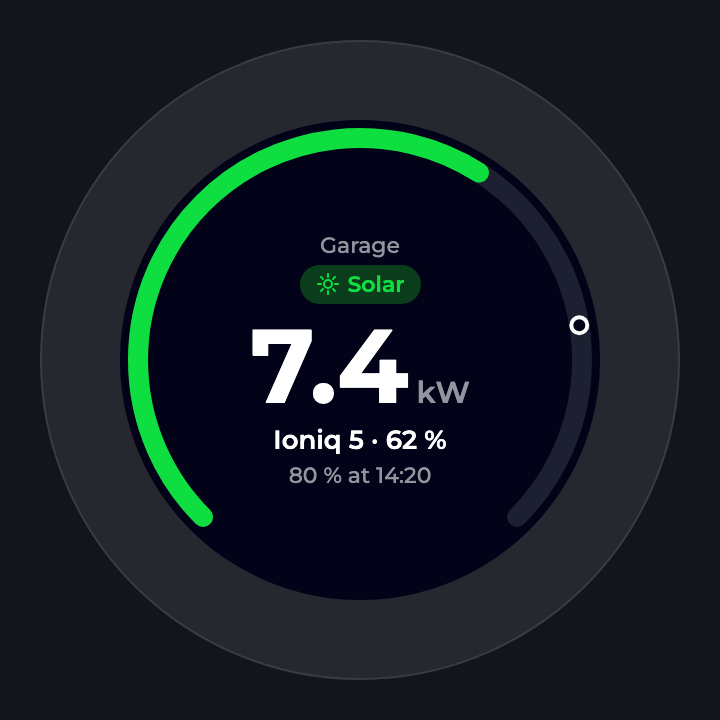
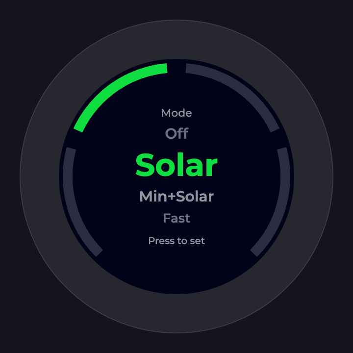
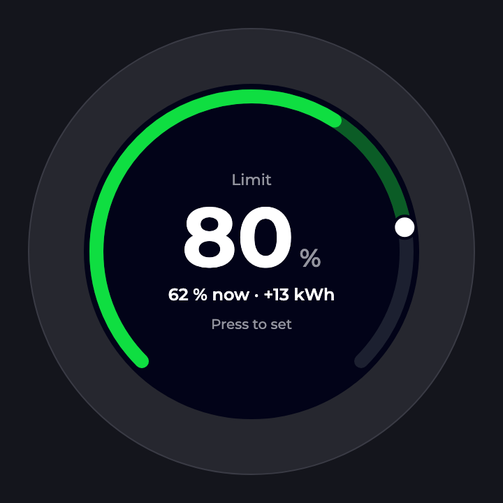
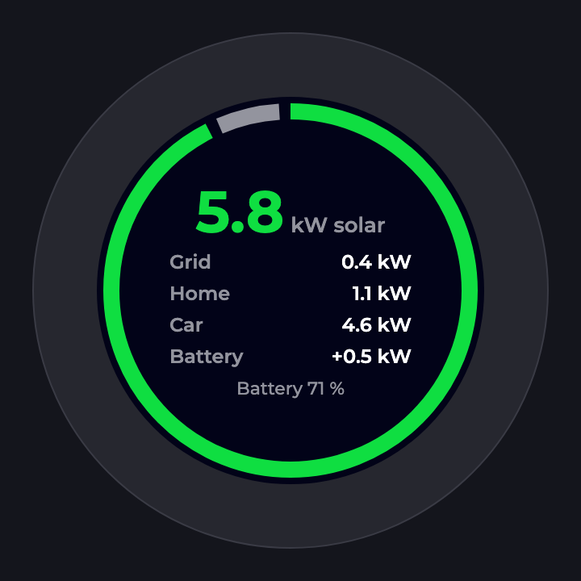
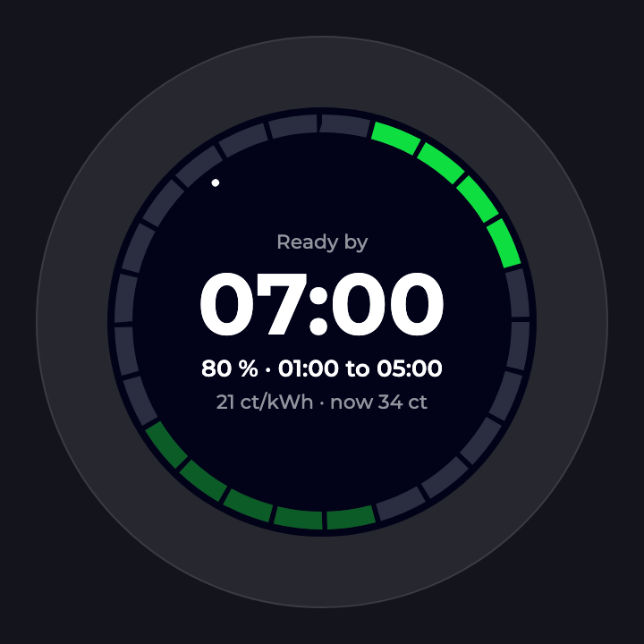
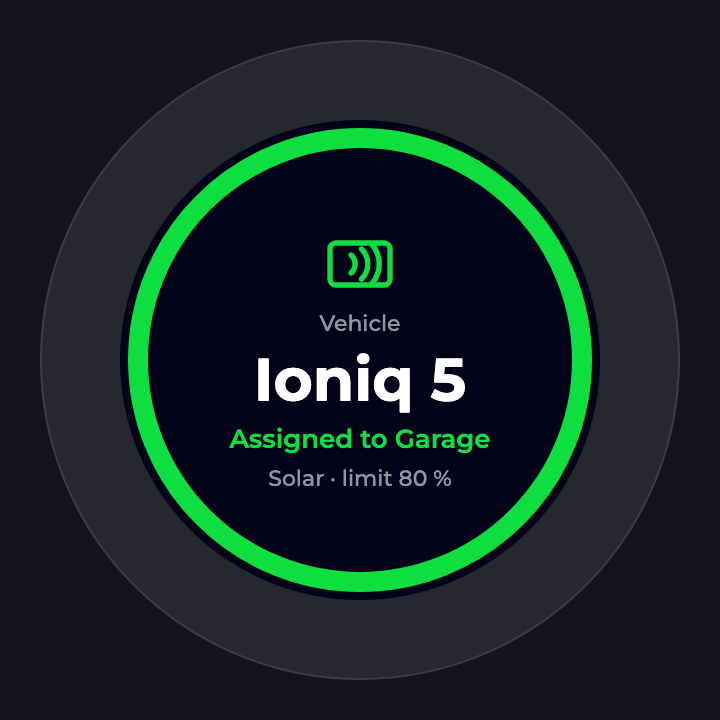

# smart-knob

An [evcc](https://evcc.io) remote for the [M5Stack Dial](https://shop.m5stack.com/products/m5stack-dial-v1-1).
One dial controls one loadpoint: it shows the charging state and sets mode, limit and vehicle.

Status: compiles, not yet tested on hardware.

<p>
  
  
  
  
  
  
</p>

The image is the design. The firmware uses built-in fonts and simpler shapes.

## Controls

| Input | Action |
|---|---|
| Rotate (on home) | Pick mode: Off, Smart, Smart 1× (always charge once), Smart ∞ (always charge), Fast. Press to set. |
| Press (on home) | Edit the SoC limit in 5% steps. Press to set. |
| Swipe left/right | Switch page: home, energy flow, plan. |
| Press (other pages) | Back to home. |
| Long press | Pick the loadpoint. Rotate, press to select. The choice is saved. |
| RFID tag | Assign the mapped vehicle to the loadpoint. |

Nothing changes without a press. Mode and limit editors close after 5 s.

## Pages

- **Home**: charge power, mode, vehicle and SoC. The ring is the SoC, the marker is the limit.
- **Energy flow**: solar, grid, home, car and battery power. The ring is the solar share.
- **Plan**: departure time, target SoC and charging window. The ring is a 24 h clock
  of grid prices: bright green is planned charging, dark green is the cheapest third.

## Build

Needs [PlatformIO](https://platformio.org) and a USB-C cable.

```sh
cp include/config.example.h include/config.h
pio run -t upload
```

Without a PlatformIO install: `uvx platformio run -t upload`.

## Simulator

The same code runs on a desktop against a real evcc. Needs SDL2 (`brew install sdl2`).

```sh
make run
```

| Input | Stands for |
|---|---|
| Mouse wheel, or left / right arrow | Rotate |
| Space or return | Press; hold for a long press |
| Mouse drag | Swipe |
| T | RFID tag with UID `deadbeef` |

Mode, limit and vehicle changes are sent to the evcc in `EVCC_URL`, as on the device.
`SIM_SHOT=file.png pio run -e sim -t exec` saves the first frame with data and exits.

## Configuration

All settings are in `include/config.h`, which is not committed.

| Setting | Meaning |
|---|---|
| `WIFI_SSID`, `WIFI_PASS` | WiFi credentials |
| `EVCC_URL` | evcc base URL, for example `http://evcc.local:7070`, no trailing slash |
| `LOADPOINT` | Loadpoint shown on first boot, 1-based as in the evcc API |
| `ENC_STEP` | Encoder counts per detent. Change it if one click moves no step or several. |
| `TAGS` | RFID tag UID (lowercase hex) to evcc vehicle name |

To find a tag's UID, hold it to the dial: an unknown tag shows its UID on screen.
The vehicle name is the evcc name (such as `vehicle_1`), not the title.

## How it works

- A background task polls `GET /api/state?jq=…` every 3 s. The jq program in
  `include/query.h` runs inside evcc and returns about 1 kB instead of the full state.
  It also does all time handling, so the dial needs no NTP and no timezone.
- Changes go through `POST /api/loadpoints/<n>/mode/<mode>`, `/limitsoc/<soc>` and
  `/vehicle/<name>`.
- The UI loop never waits for the network. A changed mode or limit is shown at once
  and confirmed by the next poll.

## Fonts

The firmware embeds [Montserrat](https://github.com/JulietaUla/Montserrat) (SIL Open Font
License, see `tools/Montserrat-OFL.txt`) as anti-aliased bitmap fonts in `src/fonts.h`.
To change sizes or characters, edit `tools/mkfonts.py` and run
`uv run --with pillow python tools/mkfonts.py <dir with Montserrat-*.ttf>`.

## Limitations

- Plain HTTP only.
- Prices are shown as ct/kWh, which assumes a currency with a 1/100 subunit.
- No WiFi setup screen and no over-the-air update: settings need a rebuild.
